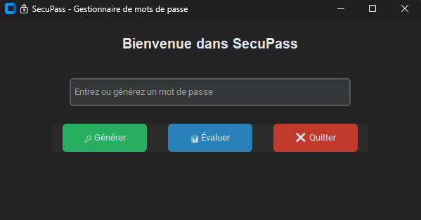
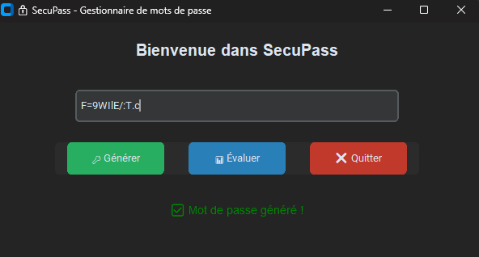
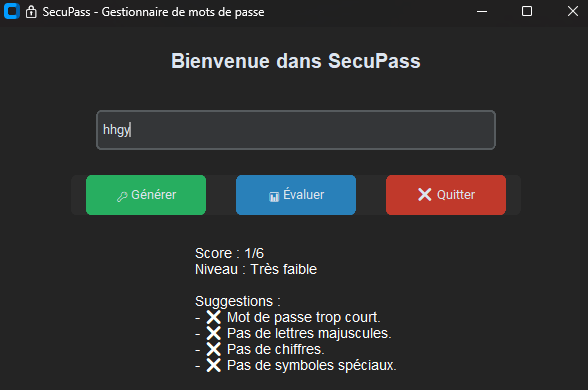
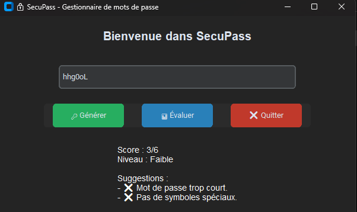
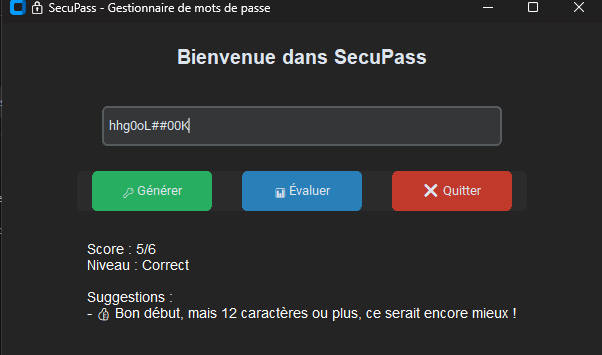
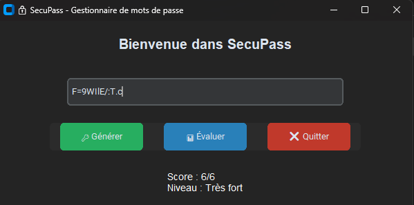
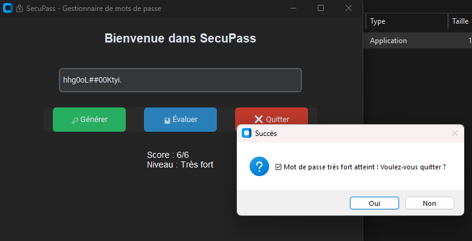

# 🔐 SecuPass

> Outil éducatif en Python pour **générer**, **évaluer** et **comprendre** la robustesse des mots de passe.


---

## 📌 Contexte

Projet réalisé dans le cadre de ma formation d'**ingénieur en cybersécurité**. Il a pour objectifs de :

- mettre en pratique les bonnes pratiques de **génération cryptographiquement sûre** de secrets ;
- implémenter un **évaluateur heuristique** de robustesse de mots de passe ;
- fournir un **retour pédagogique** à l'utilisateur sur les critères de sécurité.

> ⚠️ **Projet pédagogique** : il ne remplace ni un gestionnaire de mots de passe, ni un audit de sécurité.

---

## ✨ Fonctionnalités

### 1. Générateur de mots de passe (`generator.py`)
- Utilise le module [`secrets`](https://docs.python.org/3/library/secrets.html) (CSPRNG) et **non** `random`, qui n'est pas adapté à un usage cryptographique.
- Alphabet de 94 caractères : minuscules, majuscules, chiffres, symboles.
- Garantit la présence d'**au moins un caractère de chaque catégorie**.
- Rejette les mots de passe contenant des **mots faibles** (`password`, `azerty`, `qwerty`, `admin`…) ou des **motifs simples** (`123`, `abc`, `2024`, `000`…).
- Longueur par défaut : **12 caractères** (≈ 78 bits d'entropie théorique : 12 × log₂(94)).

### 2. Évaluateur de robustesse (`evaluator.py`)
Score de **0 à 6** calculé selon les critères suivants :

| Critère | Points |
|---|---|
| Longueur ≥ 12 | +2 |
| Longueur entre 8 et 11 | +1 |
| Présence de minuscules | +1 |
| Présence de majuscules | +1 |
| Présence de chiffres | +1 |
| Présence de symboles | +1 |
| Motif faible détecté (`123`, `abc`, `password`, `azerty`, `qwerty`, `2024`) | −1 |
| Caractères de contrôle / invisibles | −1 |
| Présence d'un espace | −1 |

| Score | Niveau |
|---|---|
| 0 – 1 | Très faible |
| 2 – 3 | Faible |
| 4 – 5 | Correct |
| 6 | Très fort |

Chaque faiblesse détectée produit une **recommandation personnalisée**.

### 3. Interfaces
| Fichier | Description |
|---|---|
| `main.py` | Interface en ligne de commande (menu interactif) |
| `main_modern.py` | Interface graphique moderne (mode sombre) avec [CustomTkinter](https://github.com/TomSchimansky/CustomTkinter) |
| `test.py` | Boucle de test rapide de l'évaluateur en console |


---

## 📸 Aperçu

### Interface graphique

| Écran d'accueil | Génération d'un mot de passe |
|:---:|:---:|
|  |  |

### Évaluation de la robustesse

| Très faible (1/6) | Faible (3/6) |
|:---:|:---:|
|  |  |

| Correct (5/6) | Très fort (6/6) |
|:---:|:---:|
|  |  |

Lorsqu'un mot de passe « Très fort » est atteint, l'application propose de quitter :



---

## 🗂️ Structure du projet

```
SecuPass/
├── generator.py        # Génération sécurisée de mots de passe
├── evaluator.py        # Évaluation de la robustesse
├── main.py             # Interface CLI
├── main_modern.py      # Interface graphique (CustomTkinter)
├── test.py             # Test interactif de l'évaluateur
├── images/             # Captures d'écran du README
├── requirements.txt
├── .gitignore
└── README.md
```

---

## 🚀 Installation

**Prérequis** : Python 3.10 ou supérieur.

```bash
# 1. Cloner le dépôt
git clone https://github.com/<votre-utilisateur>/<nom-du-depot>.git
cd <nom-du-depot>

# 2. (Recommandé) Créer un environnement virtuel
python -m venv venv
source venv/bin/activate        # Windows : venv\Scripts\activate

# 3. Installer les dépendances (uniquement pour l'interface graphique)
pip install -r requirements.txt
```

La version console n'utilise que la **bibliothèque standard** de Python.

---

## 💻 Utilisation

### Interface console
```bash
python main.py
```
```
============================================================
                   BIENVENUE DANS SECUPASS
============================================================
 MENU PRINCIPAL
1. Générer un mot de passe sécurisé
2. Évaluer un mot de passe
3. Quitter
```

### Interface graphique
```bash
python main_modern.py
```

### Utilisation en tant que bibliothèque
```python
from generator import generate_password
from evaluator import evaluate_password

pwd = generate_password(16)
print(evaluate_password(pwd))
# {'score': 6, 'strength': 'Très fort', 'feedback': []}
```

### Créer un exécutable Windows (optionnel)
```bash
pip install pyinstaller
pyinstaller --onefile --windowed main_modern.py
```

---

## 🛡️ Notions de sécurité abordées

- **CSPRNG vs PRNG** : choix de `secrets` plutôt que `random`.
- **Entropie** : taille de l'alphabet et longueur comme facteurs de résistance au brute-force.
- **Politiques de complexité** et leurs limites.
- **Hygiène de saisie** : détection des caractères de contrôle et espaces accidentels.

---

## ⚠️ Limites connues

L'évaluateur est **heuristique** et volontairement simple :

- ne mesure pas l'entropie réelle (un mot de passe peut satisfaire tous les critères et rester prévisible, ex. `Azerty!2024x` est pénalisé, mais `Soleil#Paris9` passe malgré une structure courante) ;
- n'utilise **pas de dictionnaire** étendu (type RockYou) ni de détection de séquences clavier avancée ;
- ne vérifie pas si le mot de passe a fuité (ex. API [Have I Been Pwned](https://haveibeenpwned.com/API/v3#PwnedPasswords) en *k-anonymity*) ;

---

## 🔭 Pistes d'amélioration

- [ ] Calcul d'entropie (formule de Shannon / bibliothèque `zxcvbn`)
- [ ] Vérification des fuites via HIBP (k-anonymity)
- [ ] Dictionnaire de mots de passe courants en fichier externe
- [ ] Options de génération (longueur, jeux de caractères, passphrases)
- [ ] Tests unitaires (`pytest`) et intégration continue (GitHub Actions)

---

## 🧰 Technologies

- **Python 3** : `secrets`, `string`
- **CustomTkinter** : interface graphique
- **PyInstaller** : packaging en exécutable

---

## 📄 Licence

Distribué sous licence **MIT** (à adapter selon votre choix).

---

## 👤 Auteur

**<Votre Nom>** : étudiant ingénieur en cybersécurité
[LinkedIn](https://linkedin.com/in/<votre-profil>) · [GitHub](https://github.com/<votre-utilisateur>)

> *Ne saisissez jamais vos vrais mots de passe dans un outil dont vous ne maîtrisez pas le code.*
